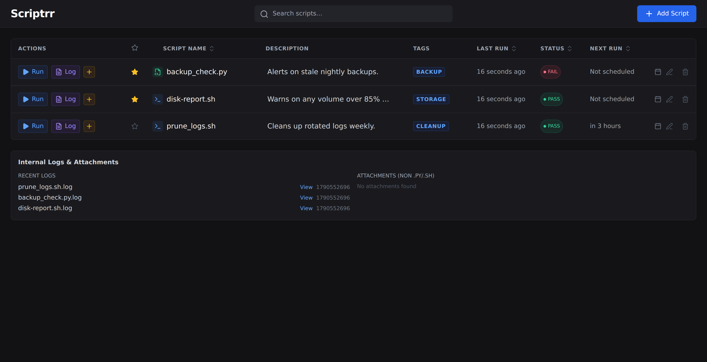

# scriptrr

**Agents write the scripts. Scriptrr runs, remembers, and retires them. You stay in control.**

One lightweight container over plain `.py` / `.sh` files on disk, with two faces:

- a dark-mode **Human Flight Deck** (`/v2/dashboard`) — what exists, what's scheduled,
  what's failing, what's safe to run, and what has closed itself out; and
- an **agent-native surface** — a JSON REST API (`/api/v1`) and a built-in
  **MCP server** (`/mcp`) with first-class safety guardrails.

Nothing is required. Drop a script in and it is listed, readable, runnable on
demand. Add a schedule when you want one. Give it a lifecycle when it is a
standing intention.



Every recurring job follows one loop: **declare why → run → observe → notify →
act → close**. Scriptrr holds the whole loop as one contained object — so you can
see what a job is *for*, when it *runs*, whether it's *alive*, what it *last
said*, whether an *agent may run it autonomously*, and when it *ends*.

## Why

- **Everything is opt-in.** A script with no schedule, no state, no alerts is not
  incomplete. It is a first-class citizen.
- **Your scripts stay yours.** Plain files, self-contained, runnable outside
  scriptrr. It holds intent — never a cage.
- **One loop, done well.** No executors, no orchestration. The job owns its
  lifecycle.
- **Contained and human-legible** is the product. If a feature doesn't serve the
  loop, it doesn't belong.

## Features

- **List & run** any `.py` / `.sh` script from a clean web dashboard.
- **Live output** while a run is in progress, plus a per-run **log** view.
- **Cron scheduling** per script, with a human-readable next-run time — and a
  scheduler that **auto-reconciles**: edits made straight to SQLite (by an agent,
  a script, or `sqlite3` on the host) are picked up within seconds, no restart.
- **Safety tiers** carried in the app, not in prose:

  | Tier | Meaning | Agent behaviour |
  |---|---|---|
  | `green` | read-only, tag-only, or dry-run by default | run freely |
  | `cautious` | mutates / moves / deletes real data | must pass `confirm_cautious=true` after human approval, or use `--dry-run` |
  | `helper` | library / utility (alert shim, patch script) | listed, but not a standalone job |

  A `cautious` script is refused with `409 Conflict` unless explicitly confirmed.
- **Flight-deck filter pills** — Active · Green-light · Cautious · Scheduled ·
  Failing · Nudges/Retired · Helpers · All. Helpers and retired nudges are hidden
  from the default view so the table stays focused on live jobs.
- **Run provenance** — every run records `last_trigger` (`schedule` / `manual` /
  `agent`) and `last_duration`, shown under *Last Run*.
- **Standing intentions that retire themselves** — an optional `expires_at` date
  plus the exit-code `42` convention (see below).
- **Edit in place**, **arguments** with saved defaults, **descriptions, tags,
  starring, search**, **upload/create**.

## Quick start

```sh
docker run -d \
  --name scriptrr \
  -p 8000:8000 \
  -v "$PWD/scripts:/app/scripts" \
  zenxedo/scriptrr:latest
```

Open <http://localhost:8000/>. Anything mounted at `/app/scripts` shows up in the
dashboard. To keep metadata and logs across container rebuilds, mount those too:

```sh
  -v "$PWD/scripts:/app/scripts" \
  -v "$PWD/data/scriptrr.db:/app/scriptrr.db" \
  -v "$PWD/data/logs:/app/logs" \
```

> **Running as non-root.** The image runs as uid `1000`, so the host files you
> mount must be writable by that user — e.g. `chown -R 1000:1000 ./data`.

### Image tags

| Tag | Tracks | Use when |
|---|---|---|
| `latest` | newest tagged release (stable) | you want released versions only |
| `edge` | newest commit on `main` | you want fixes as soon as they land |
| `1.2.3` / `1.2` / `1` | a specific release | you need it pinned |
| `sha-abc1234` | a specific commit | precise debugging |

### Docker Compose

```yaml
services:
  scriptrr:
    image: zenxedo/scriptrr:latest
    container_name: scriptrr
    ports:
      - "8000:8000"
    volumes:
      - ./scripts:/app/scripts
      - ./data/scriptrr.db:/app/scriptrr.db
      - ./data/logs:/app/logs
    restart: unless-stopped
```

## Agent-native surface

### MCP server (`POST /mcp`)

A zero-dependency MCP **Streamable HTTP** endpoint built into the app — point
`lazy-mcp`, OpenCode, Claude Code, or any MCP client at
`http://<host>:8000/mcp`:

```json
{ "name": "scriptrr", "type": "remote", "url": "http://scriptrr:8000/mcp" }
```

Tools: `scriptrr_list_scripts`, `scriptrr_get_script`, `scriptrr_run_script`,
`scriptrr_upsert_script`, `scriptrr_retire_script`.

### REST API (`/api/v1`)

| Method & path | Purpose |
|---|---|
| `GET /api/v1/scripts` | list with `safety`, `tag`, `status`, `scheduled`, `include_retired`, `q` filters |
| `GET /api/v1/scripts/{script}` | one script + `log_tail`, optional `content` |
| `POST /api/v1/scripts` / `PUT /api/v1/scripts/{script}` | create or replace (content + metadata) |
| `PATCH /api/v1/scripts/{script}` | partial metadata/content update, scheduler re-synced immediately |
| `POST /api/v1/scripts/{script}/run` | run with `{"args","wait","timeout","confirm_cautious","trigger"}` |
| `POST /api/v1/scripts/{script}/stop` | stop a run |
| `POST /api/v1/scripts/{script}/retire` | retire + unschedule with a `reason` |
| `GET /api/v1/scripts/{script}/log?tail=200` | log tail |

Example — an agent checking what it may run on its own:

```sh
curl -s 'http://scriptrr:8000/api/v1/scripts?safety=green&scheduled=true' | jq '.[].name'
```

Set `SCRIPTRR_API_TOKEN` to require a `Bearer` token (off by default — the app is
a trusted-LAN tool).

## Standing intentions that close themselves out

A *nudge* is a standing intention: *"I already decided to act when X happens;
ping me when X happens, then stop."* In scriptrr v0.2 the job declares its own
end, and scriptrr enforces it:

1. **Expiry date** — set `expires_at` (`YYYY-MM-DD`) on the schedule. Once the
   date passes, scriptrr clears the cron entry, marks the script `retired`, and
   records `expired <date>` as the reason.
2. **Exit code `42`** — the zero-boilerplate self-retire convention:

   ```python
   if condition_met:
       notify(title, message)
       raise SystemExit(42)   # alert once, then retire: scriptrr unschedules it
   ```

   The run is recorded as a success, the schedule is cleared, and
   `retired_reason` becomes `self-retired (exit 42)`.
3. **Explicit API** — `POST /api/v1/scripts/{script}/retire` (or the tool
   `scriptrr_retire_script`) with a human-readable `reason`.

Retired rows stay visible under the **Nudges / Retired** pill (with the reason on
hover) so the audit trail survives the retirement.

### Run environment

Every child process receives:

| Variable | Value |
|---|---|
| `SCRIPTRR_API` | base URL of the runner (default `http://127.0.0.1:8000`) |
| `SCRIPTRR_SCRIPT` | the script filename |
| `SCRIPTRR_TRIGGER` | `schedule`, `manual`, or `agent` |

## Script dependencies

The published image ships only the app. Scripts can get dependencies three ways
(or bake them all in at once).

### PEP 723 inline dependencies (recommended — `uv` is bundled)

`uv` is included in the image, so a script can declare its own deps:

```python
# /// script
# requires-python = ">=3.11"
# dependencies = ["requests", "PyYAML"]
# ///
import requests
```

Scriptrr detects the header and launches it with `uv run --script`; scripts
without it run with plain `python3 -u`.

### Install at start with env vars (built in)

The image entrypoint honours two space-separated env vars — no `command:`
override needed:

```yaml
services:
  scriptrr:
    image: zenxedo/scriptrr:latest
    user: "0:0"                # only needed for apt packages / root-owned secrets
    environment:
      EXTRA_APT_PACKAGES: "jq"
      EXTRA_PIP_PACKAGES: "requests"
```

Installs run on each container start and persist for its life.

### A thin derived image

```dockerfile
FROM zenxedo/scriptrr:latest
USER root
RUN apt-get update && apt-get install -y --no-install-recommends jq \
    && rm -rf /var/lib/apt/lists/*
RUN pip install --no-cache-dir requests
USER scriptrr
```

## How scripts run

- `.py` files run with `python3 -u` (or `uv run --script` for PEP 723);
  `.sh` files run with `bash`.
- A run's stdout/stderr is written to `logs/<script>.log`; the previous log is
  archived first.
- Scheduled runs use each script's saved **default arguments**.
- Scripts are self-contained: they carry their own config and run the same under
  scriptrr, cron, or an interactive shell.

## Security

**scriptrr ships with no authentication by default.** Anyone who can reach the
port can add, edit, run, and delete scripts — and execute arbitrary code on the
host with the container's permissions. Treat it as a trusted-LAN tool:

- Do **not** expose it directly to the internet.
- Put it behind a reverse proxy that provides auth (Authelia, oauth2-proxy,
  basic auth), or reach it over a VPN / Tailscale.
- Mount only the paths your scripts actually need. Mounting the Docker socket or
  a broad host path widens the blast radius.
- Safety tiers are a guardrail against *accidental* agent runs, not a security
  boundary. Set `SCRIPTRR_API_TOKEN` if the port is shared.

## License

MIT — see [LICENSE](LICENSE).
